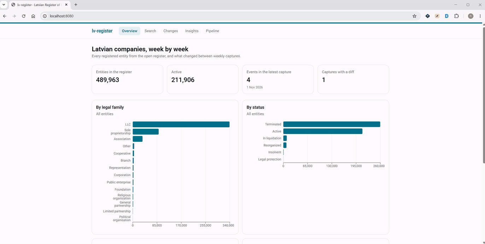
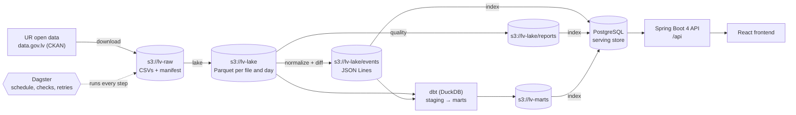

# lv-register

**The Latvian company register as clean data, a change feed, an API and a web app.**

lv-register downloads the open data of the Latvian Register of Enterprises (Uzņēmumu
reģistrs, UR) every week. It keeps every capture in a data lake, turns it into typed company
snapshots, and compares each snapshot with the previous one. The result is a feed of
change events: new companies, name, address and management changes, terminations. A Java
pipeline does the work, Dagster schedules and checks it, dbt models and tests it in SQL,
and a Spring Boot API and a React app serve it.

Latvia is the Baltic country North Data doesn't cover yet. The register publishes on
[data.gov.lv](https://data.gov.lv/dati/lv/organization/ur) under CC0, updated daily.



**Status:** a working prototype. Milestones 1–9 of [PLAN.md](PLAN.md) are done: the full
pipeline runs on real captures (489,963 companies, 671,912 company roles), orchestrated by
Dagster, served by the API and the frontend. Milestone 10 (polish: this README, ADRs, the
demo) is in progress.

---

## Contents

- [What it does](#what-it-does)
- [Architecture](#architecture)
- [Run it yourself](#run-it-yourself)
- [Everyday commands](#everyday-commands)
- [How the pipeline works](#how-the-pipeline-works)
- [The API](#the-api)
- [The frontend](#the-frontend)
- [Testing and CI](#testing-and-ci)
- [Configuration](#configuration)
- [Project layout](#project-layout)
- [Troubleshooting](#troubleshooting)
- [Personal data](#personal-data)
- [Design decisions](#design-decisions)
- [Documentation](#documentation)
- [Roadmap](#roadmap)

## What it does

| | |
|---|---|
| **Captures the register** | Finds the 11 UR files in the data.gov.lv catalog, downloads them (783 MB per capture), and records a sha256 manifest. A capture never changes once written. |
| **Keeps history** | UR publishes only the current state. The Parquet lake on S3-compatible storage (SeaweedFS) is the only copy of past states, and every reprocessing reads from it. |
| **Cleans and types** | Pure Java functions normalize names, addresses, legal forms and statuses into North-Data-style families. Every dropped or flagged row is counted per rule; nothing disappears silently. |
| **Derives change events** | Compares two snapshots: `Registered`, `NameChanged`, `AddressChanged`, `LegalFormChanged`, `ManagementChanged`, `OwnershipChanged`, `StatusChanged`, `Terminated`, `MissingFromSnapshot`. Event ids are deterministic, so re-running a capture creates no new events. |
| **Checks quality** | A quality report per capture: rows read and kept per file, drops per rule, unmapped values, orphan roles, event spikes, storage. Blocking Dagster checks stop a bad capture before it reaches users. |
| **Models in SQL** | dbt over DuckDB builds marts (companies, events, stats, mass-registration addresses) and re-computes the diff in SQL. A dbt test requires it to match the Java diff. |
| **Orchestrates** | Dagster: a weekly schedule (Monday 06:00 Riga) with an off/on switch, asset checks, retries, a failure alert, reprocessing of past captures, and bounded retention. |
| **Serves** | PostgreSQL behind a swappable `serving` port. A read-only Spring Boot 4 API with search, paging, rate limiting, ProblemDetail errors, health and OpenAPI. A React frontend with search, company pages, a d3 ownership network, the change feed and the pipeline's quality reports. |

## Architecture



- **Java 25 pipeline** (plain Java, Picocli, no framework): `download → lake → diff → quality
  → (dbt) → index → prune`. Each step reads and writes objects for one capture, so it can run
  alone: `lv-register <step> --date YYYY-MM-DD`.
- **Dagster** starts the same CLI in the `cli` container through Dagster Pipes and receives
  metadata and check results from Java.
- **Storage:** SeaweedFS provides the S3 API locally. Nothing talks to Amazon; any
  S3-compatible store works by changing `S3_ENDPOINT`.
- **Serving:** only the `serving-postgres` adapter knows SQL. Everything else uses the
  `serving` port, so an Elasticsearch adapter can replace it (ROADMAP.md section 4).
- **Module rules** are enforced by ArchUnit in the build: only `api` imports Spring, `domain`
  imports nothing outside the JDK, and nothing depends on the CLI or the API.

The full design is in [docs/architecture.md](docs/architecture.md). The layer design
follows [Oversee](https://github.com/cashewcodes9/Oversee), the same architecture in Python.

### Tech stack

| Area | Technology |
|---|---|
| Pipeline | Java 25, Gradle (Kotlin DSL), Picocli, DuckDB JDBC, AWS SDK v2 (S3 client only) |
| Lake | SeaweedFS (S3 API), Parquet (ZSTD), DuckDB with `httpfs` |
| Modelling and data tests | dbt-duckdb |
| Orchestration | Dagster (assets, partitions per capture, Pipes, schedules, sensors) |
| Serving | PostgreSQL 18, plain JDBC + HikariCP, Flyway, `pg_trgm` + `unaccent` search |
| API | Spring Boot 4, Bucket4j, Caffeine, springdoc OpenAPI, Actuator |
| Frontend | React 19, TypeScript, Vite, shadcn/ui, TanStack Query, Recharts, d3.js |
| Tests | JUnit 5, AssertJ, jqwik, Testcontainers, ArchUnit, pytest, Vitest, Playwright |
| Runtime | Docker Compose; GitHub Actions CI |

## Run it yourself

Everything builds and runs in Docker. The host needs only **Docker, git and make**: no JDK,
Node or Python.

### Requirements

| | Minimum | Notes |
|---|---|---|
| Docker | Engine 24+ with Compose v2 | Docker Desktop on macOS and Windows |
| CPU | 1 core | everything runs one step at a time; more cores only make it faster |
| Memory for Docker | 4 GB | the diff step peaks at about 2.2 GB. With Docker Desktop, give it 6 GB |
| Disk | about 10 GB free | images, 2 raw captures, 12 lake snapshots, PostgreSQL (about 0.9 GB) |
| Network | access to data.gov.lv | only for downloading captures |

- **Linux and macOS:** run the commands below in a terminal.
- **Windows:** use WSL 2 (Ubuntu) with Docker Desktop's WSL integration, and clone the repo
  inside the WSL file system (`~/…`, not `/mnt/c/…`). The Makefile uses `id` and `stat`, so
  it needs a Unix shell.

### Quick start

```sh
git clone https://github.com/cashewcodes9/lv-register.git
cd lv-register
cp .env.example .env    # optional: every value has a local default
make up                 # builds the images, starts all services, waits until healthy
make capture-now        # queues today's capture in Dagster
```

Then open:

| What | URL |
|---|---|
| Frontend | http://localhost:8080 |
| API docs (Swagger UI) | http://localhost:8080/api/docs |
| Dagster (asset graph, runs, checks) | http://localhost:3000 |
| SeaweedFS file browser | http://localhost:8888 |

What to expect:

- The first `make up` builds the Java, frontend and Dagster images: allow 10–15 minutes.
- A capture takes about **25 minutes on 1 CPU**. Follow it in Dagster under *Runs*. The
  frontend shows data once the `search_index` asset is done.
- The **first capture is the baseline** and has no events. Change events appear from the
  second capture on: the next weekly run, or `make capture-now` on a later day.
- All ports are bound to `127.0.0.1`. To use the stack from another machine, use an SSH
  tunnel, for example `ssh -N -L 8080:localhost:8080 -L 3000:localhost:3000 user@host`.

### Without Dagster

The Java steps run alone too, for example for debugging:

```sh
make run DATE=2026-11-02    # download, lake, diff, quality, index, prune for one capture
make dbt-build              # dbt seed, run and test over the lake
```

`download` only fetches today's capture (Riga date). A past date works only if its raw files
are already in the lake.

### Stop and reset

```sh
make down                   # stops everything; data stays in the Docker volumes
make up                     # starts again; the weekly schedule continues
docker compose down -v      # deletes all data (lake, PostgreSQL, Dagster history)
```

## Everyday commands

`make help` lists all targets.

| Command | Does |
|---|---|
| `make up` / `make down` | start (and wait until healthy) / stop the stack |
| `make status` | services, schedule state, captures, last runs, bucket usage, database sizes |
| `make capture-now` | queue a capture now; `DATE=YYYY-MM-DD` reprocesses a past capture from the lake |
| `make capture-off` / `make capture-on` | pause / resume the weekly schedule (the stack keeps running) |
| `make run DATE=…` | all Java steps for one capture, without Dagster |
| `make dagster` | rebuild and restart Dagster after changes |
| `make api` | rebuild and restart the API and frontend |
| `make web-dev` | Vite dev server with hot reload on http://localhost:5173 |
| `make dbt-build` | dbt over the real lake |
| `make dbt-docs` | dbt docs with the lineage graph on http://localhost:8081 |
| `make duckdb` | DuckDB CLI on `./data` |
| `make build` | Gradle build with all Java tests (in the `build` container) |
| `make test` | Java tests only |
| `make dagster-test` | pytest of the Dagster definitions |
| `make dbt-fixtures` | dbt build on committed fixtures (no S3 needed) |
| `make web-check` | frontend: install, types, lint, tests, production build |
| `make web-smoke` | headless browser over every page of the running stack |
| `make openapi` | regenerate `web/openapi.json`, which the frontend types come from |

## How the pipeline works

| Step | Module | Does |
|---|---|---|
| 1. download | `ingest` | looks up the 11 files in the CKAN catalog, downloads with retries, computes sha256 while streaming, writes a manifest |
| 2. lake | `lake` | CSV → Parquet with DuckDB, source sha256 in the metadata; skipped if already done |
| 3. normalize | `normalize` | pure functions: trim, Unicode NFC, validate registration numbers, map legal forms and statuses; drops counted per rule |
| 4. diff | `diff` | compares this snapshot with the previous capture in the lake and writes events as JSON Lines, sorted by a deterministic id |
| 5. quality | `quality` | run record and quality report: OK, WARN or FAILED, with the warnings that triggered it |
| – dbt | `transform/` | staging → intermediate → marts; the SQL diff must match the Java diff |
| 6. index | `index` | upserts companies, events, the report, stats and features into the serving store |
| 7. prune | `quality` | retention: raw CSVs for 2 captures, lake snapshots for 12, events and reports kept for good |

In Dagster, each step is an asset partitioned by capture date, with checks. Blocking checks
(in bold) stop the run:

| Asset | Checks |
|---|---|
| `ur_raw_files` | **files_complete**, size_change; fails after 8 days without a capture |
| `lake_snapshot` | **schema_unchanged** |
| `company_events` | **event_spike** |
| `quality_report` | **drop_share**, **register_not_empty**, orphan_roles, unmapped_values, row_change, duplicate_regcodes, event_volume |
| dbt models | every dbt test |
| `search_index` | counts_match_marts |
| `retention` | storage_below_warn |

**Idempotency:** a capture is fixed once written. Running a step twice gives byte-identical
objects, and event ids are a hash of their content, so re-running never duplicates events.
Details: [architecture.md, "Idempotency"](docs/architecture.md#idempotency).

## The API

Read-only, under `/api`. The OpenAPI spec and Swagger UI are at `/api/docs`.

| Endpoint | Returns |
|---|---|
| `GET /api/search?q=&page=&size=` | companies by name or registration number; ignores case and Latvian diacritics, tolerates typos |
| `GET /api/companies/{reg}` | one company with officers, owners and beneficial owners |
| `GET /api/companies/{reg}/events` | the company's change timeline |
| `GET /api/companies/{reg}/network` | two-hop graph: the company, its people and their other companies |
| `GET /api/events?date=&type=` | the change feed |
| `GET /api/stats` | companies per legal form, status and region; events per capture |
| `GET /api/runs`, `GET /api/runs/{id}` | pipeline runs and their quality reports |
| `GET /api/features/mass-addresses` | addresses where many companies are registered |
| `GET /actuator/health` | health, including the serving store's latest capture |

Errors are RFC 9457 `ProblemDetail` responses (400, 404, 429). Each client IP gets a burst of
30 requests, refilled at 120 per minute. Search and stats are cached for 10 minutes.

```sh
curl 'http://localhost:8080/api/search?q=rigas%20udens'
```

### Why the overview and insights are fast: precomputed marts

Aggregates over the whole register are computed **once per capture** by dbt (DuckDB over
the Parquet lake), not on every request. The index step copies the finished results into
small PostgreSQL tables, so the API reads a few thousand rows instead of grouping 490,000
companies:

| Question | Precomputed (mart → PostgreSQL) | Computed live in PostgreSQL |
|---|---:|---:|
| Companies by legal form, status and region | **0.5 ms** | 9.7 s |
| Mass-registration addresses, first 20 | **0.17 ms** | 38.6 s |

Measured on the real register, on a 1-CPU VM. Lookups that can't be precomputed (search,
one company, its events and network) use PostgreSQL indexes directly. More in the
[FAQ](docs/FAQ.md#why-are-the-overview-and-insights-pages-fast-when-the-database-holds-490000-companies).

## The frontend

Spring Boot serves the production build on the same port as the API (8080).

| Page | Shows |
|---|---|
| Overview | key figures, companies by legal family, status and form, events per capture |
| Search | search as you type, paged |
| Company | facts, officers, shareholders, beneficial owners, change timeline |
| Network | d3-force graph of the people and companies around a company, in 3 levels with role filters |
| Changes | the change feed, filtered by date and event type |
| Pipeline | every run, with its quality report (files, drops, warnings, events, storage) and a link to Dagster |
| Insights | mass-registration addresses |

The TypeScript types come from the API's OpenAPI spec (`web/openapi.json`), so the
frontend and the API can't drift apart without a failing build.

## Testing and CI

| Layer | Tests |
|---|---|
| Domain and normalizers | JUnit 5 and AssertJ for every rule and mapping |
| Diff | property tests (jqwik): `diff(A, A)` is empty, applying `diff(A, B)` to A gives B, ids stable and unique |
| Idempotency | running a capture twice gives byte-identical objects |
| Storage and serving | Testcontainers against SeaweedFS and PostgreSQL; one contract test suite for every serving adapter |
| API | `@WebMvcTest` controllers, an integration test that also keeps `openapi.json` current |
| Architecture | ArchUnit module rules |
| dbt | generic and singular tests, Java/SQL diff parity on fixtures |
| Dagster | pytest: definitions load, asset graph, partitions, checks |
| Frontend | TypeScript, ESLint, Vitest; Playwright smoke test over every page |
| Privacy | no person data in CLI logs on a fixture run |

GitHub Actions ([`.github/workflows/ci.yml`](.github/workflows/ci.yml)) runs the same
containers and `make` targets on every push and pull request to `main` and `dev`.

## Configuration

Compose reads `.env` if it exists. Every value has a local default in
[`.env.example`](.env.example):

| Variables | Control |
|---|---|
| `S3_*` | S3 endpoint, keys and bucket names |
| `POSTGRES_PASSWORD`, `SERVING_*`, `DAGSTER_DB_PASSWORD` | PostgreSQL. Passwords apply only when the volume is first created |
| `LV_CAPTURE_CRON` | the weekly schedule (default Monday 06:00, Europe/Riga) |
| `LV_ALERT_WEBHOOK_URL` | optional webhook for failed runs |
| `QUALITY_*`, `STORAGE_WARN_GB` | quality warning and blocking levels |
| `RAW_KEEP`, `LAKE_KEEP` | retention: captures kept per layer |
| `CLI_JAVA_OPTS`, `DUCKDB_MEMORY_LIMIT`, `DUCKDB_THREADS` | pipeline memory |
| `API_*` | rate limit, CORS, JVM options, network graph limits |

The values in `.env.example` are local development values only. Never put real credentials
there.

## Project layout

```
modules/            Java (Gradle subprojects)
  domain/           records and sealed types, no I/O
  storage/          ObjectStore: S3 and local implementations
  ingest/ lake/ normalize/ diff/ quality/ index/    pipeline steps
  serving/          the port: ServingWriter, ServingQueries, contract tests
  serving-postgres/ the PostgreSQL adapter, Flyway migrations
  pipes/            Dagster Pipes protocol for Java
  cli/              Picocli commands, one per step
  api/              Spring Boot 4 read API
transform/          dbt project: staging, intermediate, marts, fixtures
orchestration/      Dagster definitions (Python), tests
web/                React frontend
docker/             service configs (SeaweedFS, PostgreSQL, …)
docs/               architecture, FAQ, source assessment, ADRs, search performance
scripts/            helpers for exploring raw captures
Dockerfile          multi-stage build: frontend, jars, cli and api images
docker-compose.yml  profiles core, orchestration, dev, tools
Makefile            every command above
```

## Troubleshooting

| Problem | Fix |
|---|---|
| `make up` fails on memory, or the diff step is killed | give Docker at least 4 GB (6 GB with Docker Desktop); don't run `make build` while a capture runs |
| The frontend is empty | no capture is indexed yet: `make capture-now` and wait for `search_index` in Dagster |
| No change events | the first capture is the baseline; events start with the second capture |
| A past date fails in `download` | only today's capture can be fetched. Past dates are reprocessed from the lake |
| `data/` is owned by root | create it before the first `docker compose run duckdb`, or use `make duckdb` |
| Changed PostgreSQL passwords have no effect | they apply only to a new volume: `docker compose down -v` (deletes data) |
| Search is slow while typing | known issue, measured in [docs/search-performance.md](docs/search-performance.md), fixes in ROADMAP.md section 7 |

## Personal data

Officers, members and beneficial owners in the register are personal data, even though UR
publishes them openly.

- Raw files, the lake, marts and screenshots with real names are never committed.
- The API shows persons only in the context of one company (its page and network graph). No
  endpoint lists or exports persons in bulk.
- Logs and Dagster metadata contain no person data; a test checks the CLI logs.
- EU rules on public access to beneficial ownership may narrow what Latvia publishes.

## Design decisions

Why it is built this way. Each one is answered in [docs/FAQ.md](docs/FAQ.md):

- **Events from snapshot diffs:** UR publishes only the current state, so changes come from
  comparing weekly captures. Changes between two captures appear as one net change.
- **Deterministic event ids:** a hash of the canonical event, so reprocessing is safe.
- **Plain Java in the pipeline, Spring Boot only at the API edge:** batch code gains nothing
  from a framework; the API needs rate limiting, validation, health and OpenAPI.
- **Dagster through Pipes:** Dagster schedules and checks, Java keeps the domain logic.
- **dbt-duckdb over the lake instead of a warehouse:** SQL models and tests with no extra
  database.
- **PostgreSQL for serving, Elasticsearch later:** about 1 GB less RAM on a 4 GB VM, behind
  a port with a contract test suite, so the switch is one adapter.
- **Weekly captures with bounded retention** and an off/on switch, so storage stays bounded.
- **shadcn/ui** instead of Semantic UI, which is no longer maintained.

## Documentation

| Document | Covers |
|---|---|
| [PLAN.md](PLAN.md) | goal, scope, stack and milestones |
| [docs/architecture.md](docs/architecture.md) | layers, steps, event rules, modules, serving, containers, tests |
| [docs/FAQ.md](docs/FAQ.md) | why each choice was made, what was measured and what was rejected |
| [docs/source-assessment.md](docs/source-assessment.md) | what the UR files really contain: columns, values, sizes |
| [docs/search-performance.md](docs/search-performance.md) | search measurements and bottlenecks |
| [EXECUTION.md](EXECUTION.md) | build log: state, pinned versions, environment, decisions |
| [ROADMAP.md](ROADMAP.md) | what comes after the MVP |

## Roadmap

From [ROADMAP.md](ROADMAP.md):

1. Observability: Grafana, Prometheus, Loki and Tempo with dashboards and alerts as code
2. More data: the other sources North Data combines, researched for Latvia
3. Cloud deployment
4. An Elasticsearch serving adapter
5. Module folders grouped by who uses them
6. Companies by region, with names
7. Search performance: cancel superseded searches, cheaper broad queries, timeouts

## License and data

The register data comes from the Register of Enterprises of the Republic of Latvia via
data.gov.lv under CC0 1.0.
