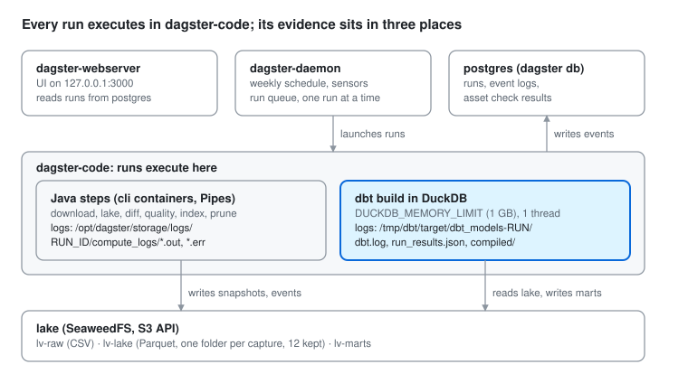

# Runbook: investigating a failed pipeline run

How to find out why a Dagster run of lv-register failed, using only the tools already in the
stack (Dagster 1.13.28, dbt-core 1.12.6, dbt-duckdb 1.11.1, DuckDB 1.4.5, Docker). How the
pipeline works is in [architecture.md](architecture.md); the incidents found with this runbook
are logged at the [end](#incident-log).

## Where the evidence is



A failed run leaves evidence in three places:

| What | Where | Survives a container rebuild? |
|---|---|---|
| Run and step events, asset check results | `dagster` database in `postgres`, shown in the Dagster UI | yes |
| stdout/stderr of each step (Java CLI output) | `/opt/dagster/storage/logs/<run_id>/compute_logs/*.out`, `*.err` in `dagster-code` (volume `dagster-storage`) | yes |
| dbt logs, results and compiled SQL | `/tmp/dbt/target/dbt_models-<run_id[:7]>-<hash>/` in `dagster-code` | **no**: `/tmp` is not on a volume |

Recreating `dagster-code` deletes the dbt logs of every past run. If an incident is still
open, copy them out first:
`docker cp lv-register-dagster-code-1:/tmp/dbt/target ./data/dbt-target-<date>` (`data/` is
not committed).

## Protocol

Work from the outside in: run → step → dbt node → query → machine. Write down what you find
at each level before you change anything. Commands run from the repo root on the VM; every
tool runs in a container. In the commands below, `$C` stands for
`docker exec -e DAGSTER_HOME=/opt/dagster/home lv-register-dagster-code-1`.

**Clocks:** the containers, `dbt.log`, `run_results.json` and `make status` use UTC, while
the VM's shell (`date`) shows CET/CEST. Before you call a step slow or stuck, compare
times in one zone: `date -u` on the host.

1. **Stop the bleeding.** One run at a time (`max_concurrent_runs: 1`), so a stuck run blocks
   the next weekly capture (Mondays 06:00 Riga). Decide whether to cancel it. If the next
   capture would fail the same way, `make capture-off`.
2. **Identify the run.** `make status` lists schedule and sensor state, captures and the last
   runs. Note run id, job, partition (capture date) and start time. The `run_failure_alert`
   sensor posts the same line to `LV_ALERT_WEBHOOK_URL` when that is set.
3. **Find the failed step.** Dagster UI at http://127.0.0.1:3000 (from your machine:
   `ssh -L 3000:127.0.0.1:3000 <vm>`): Runs → the run → Gantt view. Red steps failed, grey
   ones were skipped downstream. For `dbt_models`, the step error already lists the failed dbt
   nodes under `Errors parsed from dbt logs`.
4. **Classify the error.** Read the first real error line, not the Python traceback below it:
   for dbt the traceback always ends in `dagster_dbt … _raise_on_error` and says nothing about
   the cause. Match it to a row in [Failure classes](#failure-classes).
5. **Read the step's own logs.** Java steps: the compute log (UI, or the path above). dbt: the
   run's target directory: `run_results.json` (status, message, `execution_time` per node),
   `dbt.log` (every SQL statement with timing), `compiled/` (the SQL that ran).
6. **Compare with the last good run.** Diff the `run_results.json` of the failed run against
   the last green one, and list what changed in between: a new capture, a commit, an image
   rebuild, `.env`. A node that got slower over several runs means growth; a sudden break
   means a change. Summary of all runs still in the container:

   ```sh
   docker exec lv-register-dagster-code-1 python -c '
   import json, glob
   for f in sorted(glob.glob("/tmp/dbt/target/*/run_results.json")):
       r = json.load(open(f)); print(f.split("/")[4], r["metadata"]["generated_at"])
       for x in sorted(r["results"], key=lambda x: -x["execution_time"])[:6]:
           print("  %-7s %6.1fs %s" % (x["status"], x["execution_time"], x["unique_id"].split(".")[-1]))'
   ```

7. **Check the machine.** `docker stats --no-stream`, `free -m`,
   `docker inspect <container> --format '{{.State.OOMKilled}}'`, and the kernel log
   (`doas grep -i oom /var/log/messages`). A process killed by the kernel dies without a dbt
   or Java error; DuckDB's own `Out of Memory Error` is a query over `memory_limit`.
8. **Reproduce small, outside Dagster.** Only the failing node, at production limits:
   `docker compose --profile core run --rm dbt build --select dim_companies`. For the plan,
   paste the compiled SQL into `make duckdb` after `EXPLAIN ANALYZE`. Check first whether
   `make dbt-fixtures` passes: if it does, the logic is fine and the problem is data or scale.
9. **Fix, then re-run the smallest job that proves it.** `rebuild_marts` (dbt only),
   `reprocess_capture` (a past capture from the lake), `capture_pipeline` (everything). In the
   UI, "Re-execute from failure" reuses the steps that already succeeded.
10. **Record it.** A line in the [incident log](#incident-log), the decision in
    [EXECUTION.md](../EXECUTION.md#decisions-log), and a [FAQ](FAQ.md) entry if something was
    decided. Counts and registration numbers only: never officer or owner names in notes,
    logs, tickets or commits.

## Tools

| Layer | Tool | What it answers | How |
|---|---|---|---|
| Run | `make status` | Schedules, sensors, captures, last runs | `lvregister_orchestration.commands status` |
| Run | Dagster UI, Runs | Which step failed, its error, the timeline | http://127.0.0.1:3000 |
| Run | Dagster UI, Assets | dbt tests (asset checks) over several captures, last materialization | Asset → Checks; Partitions to compare captures |
| Run | `DagsterInstance` | Runs and step events by script, e.g. which step a stuck run is on | `$C python`, `DagsterInstance.get().get_run_records()`, `.all_logs(run_id)` |
| Run | `dagster debug export` | A run's whole event log as one file | `$C dagster debug export <run_id> /tmp/run.gz` |
| Step | Compute logs | stdout/stderr of a step | `/opt/dagster/storage/logs/<run_id>/compute_logs/` |
| dbt | `run_results.json` | Status, error and time per node | target directory of the run (protocol step 6) |
| dbt | `dbt.log` | Every SQL statement and its time; the last `START` line shows where a stuck run is | target directory; JSON lines, grep `START`, `ERROR`, `SQL status` |
| dbt | `compiled/` | The exact SQL that ran | `compiled/lv_register/models/…`, `compiled/lv_register/tests/…` |
| dbt | `dbt build --select` | One node (`+` for its children) outside Dagster | `docker compose --profile core run --rm dbt build --select dim_companies+` |
| dbt | `dbt retry` | Only what failed or was skipped in the last invocation | `docker compose --profile core run --rm dbt retry` |
| dbt | `dbt show`, `dbt compile` | Rows or SQL of one model without building it | `… run --rm dbt show --select int_companies --limit 20` |
| dbt | `make dbt-fixtures` | Logic bug or data/scale problem? | the `fixtures` target, as in CI |
| Query | `EXPLAIN`, `EXPLAIN ANALYZE` | Filter pushdown, scans, windows; time and rows per operator | `make duckdb` |
| Query | DuckDB profiling | Per-operator timing of a whole query in a file | `SET enable_profiling='json'; SET profiling_output='/tmp/p.json';` |
| Query | `duckdb_memory()`, `current_setting()` | Where memory goes; effective `memory_limit`, `threads`, `temp_directory` | `select * from duckdb_memory();` |
| Machine | `docker stats`, `free -m` | Memory and CPU per container and host | host shell |
| Machine | `docker inspect`, kernel log | Killed by the OOM killer? | `--format '{{.State.OOMKilled}}'` |
| Machine | `/proc/<pid>/task/*/stat`, `/proc/<pid>/io` | Is a long step computing (state `R`), waiting on I/O, or idle? | inside the container (the image has no `ps`) |
| Storage | DuckDB `glob()`, `read_parquet` | Which captures are in the lake, rows per capture | `read_parquet('s3://lv-lake/register/**/*.parquet', filename=true)` grouped by `date=` |

## Failure classes

| Symptom | Likely class | First checks | Usual fix |
|---|---|---|---|
| `Out of Memory Error: could not allocate block … (X/Y used)` from DuckDB | Query needs more than `memory_limit` | `run_results.json` trend; captures in the lake; `EXPLAIN` for scans not filtered by capture | Scan only the captures needed; materialize shared intermediates; then raise the limit |
| Step dies without a dbt or Java error; `OOMKilled: true` or a kernel OOM line | Container or VM out of RAM | `docker stats`, `free -m`, kernel log; what ran at the same time | Lower `DUCKDB_MEMORY_LIMIT` or `-Xmx` so everything fits in 3.9 GB |
| Java `OutOfMemoryError` in a `cli` step | JVM heap (`CLI_JAVA_OPTS`, `-Xmx2g`) | Step compute log; which capture pair the diff held | Raise `-Xmx` within the VM, or stream instead of holding both snapshots |
| Step runs far longer than usual, process in state `R`, I/O flat | Bad plan or missed filter | Last `START` line in `dbt.log`; `/proc/<pid>/io` | Cancel; `EXPLAIN ANALYZE` the compiled SQL; fix the join or filter |
| Step runs long, process sleeping, I/O flat | Waiting on S3, Postgres or a lock | `docker logs lv-register-lake-1`; Postgres `pg_stat_activity` | Restart what it waits on; check credentials and endpoint |
| dbt test `FAIL N` (not `ERROR`) | Data or logic changed | `dbt show` the test's SQL; does `make dbt-fixtures` pass? | Logic bug if fixtures fail; a source change if only real data fails (update `docs/source-assessment.md`) |
| Parity test returns rows | Java diff and SQL diff disagree | Count rows by `side` and `event_type`, no names | Fix the wrong side; marts are not trusted until both agree |
| `Binder Error`, `Catalog … does not exist`, column not found | Schema or config drift | Recent commits to `transform/`; columns vs `docs/source-assessment.md` | Fix the model or the source mapping |
| S3 `403`, `404`, connection refused | Lake down or wrong secret | `make status` bucket list; `S3_*` in `.env`; `lake` health | Restart `lake`; fix the keys |
| Run never starts, queue stuck | The single run slot is taken | Runs in `STARTED` or `QUEUED`; `run_monitoring` timeouts | Cancel the stale run; recreate `dagster-code` only when no run is active |
| Quality gate fails before dbt | Blocking check in `quality_report` | Asset checks on `quality_report` for that capture | A data incident: never override the gate to get marts out |

## Incident log

Newest first. Date · run · cause · state.

| Date | Run | Cause | State |
|---|---|---|---|
| 2026-11-09 | `bb0dadf5` (capture_pipeline, 2026-11-09), [#17](https://github.com/cashewcodes9/lv-register/issues/17) | DuckDB OOM (1 GB) in `dim_companies` and `parity_sql_diff_equals_java_events`. The views in `staging/` and `intermediate/` are recomputed over every capture in the lake by each model and test; `dim_companies` filters to the latest capture only after 28 Parquet scans and 4 window operators (`EXPLAIN`). Failures followed the capture count: 2 captures passed (2026-11-01), 3 failed the parity test (2026-11-02, missed), 4 failed both. Retention keeps 12. | Open. Proposed: narrow the scans to the captures needed and materialize `int_companies` / `int_company_roles` as tables; `DUCKDB_MEMORY_LIMIT=2GB` and `preserve_insertion_order=false` as a short-term unblock. Re-run `ef1b71c9` (2026-11-11 22:33–22:44 UTC) failed the same way. |

Lesson from this incident: a failing dbt asset check (the parity test, 2026-11-02) was the
first sign, a week before the run failed. Check errors deserve the same attention as run
failures.
